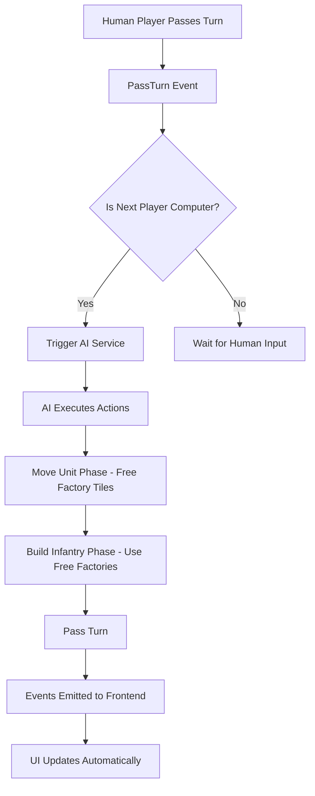

# Computer AI Mode Documentation

## Version History
- **v0.0** : Initial Player vs Computer mode implementation with basic AI
  
---

## Table of Contents
1. [Overview](#overview)
2. [Architecture Decisions](#architecture-decisions)
3. [Implementation Details](#implementation-details)
4. [AI Logic Rules](#ai-logic-rules)
5. [Key Files Reference](#key-files-reference)
6. [Testing Strategy](#testing-strategy)
7. [Future Roadmap](#future-roadmap)
8. [Contributing Guidelines](#contributing-guidelines)

---

## Overview

### Project Goal
Implement a Player vs Computer (PvC) mode for the Advance Wars OSS game, starting with a simple AI (v0) and iteratively improving it to become extremely sophisticated in terms of strategy and tactics.

### Current State (v0.0)
The initial implementation provides a functional PvC mode with a deliberately simple AI that:
- Builds Infantry units at all available factories
- Moves one Infantry unit randomly per turn
- Passes turn when no actions are available

This foundation was designed to:
1. Establish the infrastructure for AI execution
2. Integrate cleanly with the existing game architecture
3. Provide a base for iterative improvements
4. Ensure deterministic and auditable AI behavior

---

## Architecture Decisions

### 1. Server-Side AI Execution
**Decision**: Run AI logic entirely on the server
- **Rationale**: Ensures security, consistency, and prevents cheating
- **Trade-off**: Increases server load but maintains game integrity

### 2. Reuse Existing Action Pipeline
**Decision**: AI uses the same action validation and event system as human players
- **Rationale**: Ensures AI follows all game rules without duplication
- **Implementation**: Created `performAction` service that bypasses authentication

### 3. Computer as Special Player
**Decision**: Computer is a Player entity with special identification
- **Rationale**: Minimal changes to existing systems
- **Current**: Identified by hardcoded ID "computer-player-001"
- **Future**: Will use `PlayerKind` enum when database migration is ready

### 4. Event-Driven AI Triggering
**Decision**: AI turns triggered after PassTurn events
- **Rationale**: Natural integration with turn-based flow
- **Implementation**: Async execution using `setImmediate` to avoid blocking

### 5. Pathfinding Code Sharing
**Decision**: Extract pathfinding logic to shared module
- **Rationale**: Avoid code duplication between frontend and AI
- **Location**: `src/shared/match-logic/pathfinding.ts`

---

## Implementation Details

### System Flow



### Key Components

#### 1. AI Service (`src/server/services/ai-service.ts`)
- Entry point for AI turn execution
- Implements re-entrancy protection
- Orchestrates AI phases (build → move → pass)
- Handles errors gracefully

#### 2. Perform Action Service (`src/server/services/perform-action.ts`)
- Extracted 10-step action processing pipeline
- Allows AI to execute actions without authentication
- Maintains exact same validation and event flow

#### 3. Pathfinding Module (`src/shared/match-logic/pathfinding.ts`)
- `getAccessibleNodes()`: Calculates reachable tiles for a unit
- `reconstructPath()`: Builds path from origin to destination
- `calculatePathDistance()`: Computes movement cost

#### 4. AI Triggering Points
- After PassTurn in `src/server/routers/action.ts`
- After match start if computer goes first in `src/server/routers/match.ts`

---

## AI Logic Rules

### Current AI Behavior (v0.0)

#### Phase 1: Move Units
```typescript
// Rule: Move ONE random Infantry unit (FIRST to free up factory tiles)
1. Get all Infantry units owned by AI that are ready
2. Pick one random Infantry
3. Calculate all accessible tiles using pathfinding
4. Filter out current position and occupied tiles
5. Pick random destination from valid moves
6. Execute move with "wait" subaction
```

**Constraints:**
- Only moves units with `isReady = true`
- Respects movement points and terrain costs
- Avoids occupied tiles (no combat yet)
- Always uses "wait" subaction (no combat)
- **Important**: Done BEFORE building to free up factory tiles

#### Phase 2: Build Infantry
```typescript
// Rule: Build one Infantry at EACH available factory
for each factory owned by AI:
  if (factory has no unit on it AND AI has ≥ 1000 funds):
    build Infantry at factory
    deduct 1000 from funds
```

**Constraints:**
- Infantry cost: 1000 funds
- Only builds at "base" type properties
- Skips occupied factories
- Continues until funds exhausted or no valid factories
- **Important**: Done AFTER moving units to maximize available factory tiles

#### Phase 3: End Turn
```typescript
// Rule: Always pass turn after actions
Execute PassTurn action regardless of remaining possibilities
```

### Safety Mechanisms

1. **Re-entrancy Protection**: Per-match lock prevents concurrent AI execution
2. **Action Limit**: Maximum 10 actions per turn (prevents infinite loops)
3. **Error Recovery**: Always attempts to pass turn even if AI logic fails
4. **Async Execution**: Uses `setImmediate` to avoid blocking client requests

---

## Key Files Reference

### Core AI Files

| File | Purpose | Key Functions |
|------|---------|---------------|
| `src/server/services/ai-service.ts` | Main AI logic | `runAiTurn()`, `buildInfantryAtFactories()`, `moveRandomInfantry()` |
| `src/server/services/perform-action.ts` | Action execution | `performAction()` |
| `src/shared/match-logic/pathfinding.ts` | Movement calculation | `getAccessibleNodes()`, `reconstructPath()` |

### Integration Points

| File | Modification | Purpose |
|------|-------------|---------|
| `src/server/routers/action.ts` | AI trigger after PassTurn | Detect computer's turn and start AI |
| `src/server/routers/match.ts` | AI trigger at match start | Handle computer as first player |
| `src/server/routers/match/create.ts` | Computer player creation | Add computer to match when PvC selected |
| `src/frontend/components/match/card/CreateMatch.tsx` | UI checkbox | Allow user to select PvC mode |

### Database Schema

| Model | Field | Type | Purpose |
|-------|-------|------|---------|
| Player | kind | enum (human\|computer) | Identify AI players |
| Match | mode | enum (pvp\|pvc\|ai_vs_ai) | Track match type |
| Player | user | optional relation | Allow players without user account |

---

## Testing Strategy

### Manual Testing Checklist

- [ ] Create PvC match with checkbox
- [ ] Verify computer joins as second player
- [ ] Confirm AI builds Infantry at all factories with funds
- [ ] Check AI moves one Infantry randomly
- [ ] Verify AI passes turn
- [ ] Test multiple consecutive AI turns
- [ ] Verify event persistence and replay
- [ ] Check re-entrancy protection (rapid turn passing)
- [ ] Test AI with no funds
- [ ] Test AI with blocked units

### Automated Testing (Future)

```typescript
// Playwright test structure (to be implemented)
describe("Player vs Computer", () => {
  test("AI builds at multiple factories")
  test("AI movement respects rules")
  test("AI handles edge cases gracefully")
  test("Events persist correctly")
})
```

---

## Contributing Guidelines

### Adding New AI Behaviors

1. **Location**: Add logic to `src/server/services/ai-service.ts`
2. **Pattern**: Create new phase functions like `buildInfantryAtFactories()`
3. **Safety**: Respect MAX_AI_ACTIONS limit
4. **Testing**: Update manual test checklist
5. **Documentation**: Update this document's AI Logic Rules section

### Code Style for AI Development

```typescript
// Good: Explicit, debuggable AI decisions
const availableFactories = getFactoriesWithoutUnits(player);
console.log(`AI found ${availableFactories.length} factories for building`);

// Bad: Opaque one-liners
player.getProperties().filter(p => !match.getUnit(p.position)).forEach(/*...*/)
```

### Debugging AI Behavior

1. **Enable verbose logging**: Set `DEBUG=ai:*` environment variable
2. **Inspect events**: Check database for AI-generated events
3. **Use replay system**: Events are deterministic and replayable
4. **Test isolation**: Use `runAiTurn()` directly with test matches

---

## Appendix: Decision Log

### Why Start with Simple AI?

The v0.0 AI is intentionally trivial to:
1. Validate the infrastructure works end-to-end
2. Ensure clean integration with existing systems
3. Provide immediate value (playable PvC mode)
4. Establish patterns for future development
5. Make the codebase approachable for new contributors
